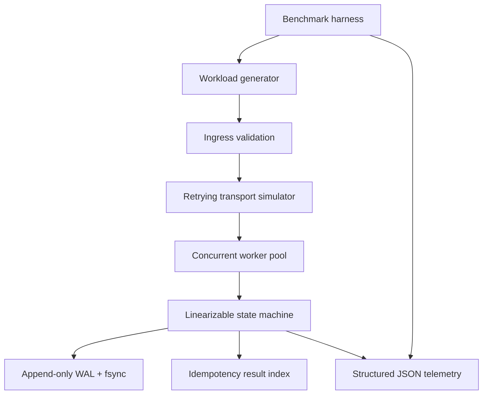

# ACPHDCO01 M1.5 — Deterministic Concurrent Processing Engine

## Scope
A reproducible laboratory implementation of a deterministic state-transition service. It provides validated operations (`add`, `set`), idempotency by operation ID, linearizable commits under a process-local mutex, append-only JSONL WAL persistence, restart recovery, JSON telemetry, concurrent workload generation, and lossy-transport retry simulation.

## Architecture

## Requirements
- Python 3.10+
- Install: `python -m venv .venv && . .venv/bin/activate && pip install -e . pytest`
- Tests: `pytest -q`
- Benchmark: `python benchmarks/run_benchmark.py --ops 10000 --workers 32 --target-rate 10000 --drop-rate 0.30`
- Docker: `docker compose up --build`

The benchmark writes a JSON report. It reports measured throughput and P50/P90/P99/P99.9 end-to-end latency in microseconds.

## Semantics and limits
- Commit order is the order in which worker threads acquire the engine lock. This is linearizable within one Python process.
- The WAL is appended and fsync'd before in-memory state mutation. Recovery replays complete contiguous records; a final incomplete line is ignored.
- Operation IDs provide at-most-once state mutation within the retained WAL. Repeated requests return the original result.
- The 30% packet-drop simulation drops requests before receiver processing. Retries use bounded decorrelated jitter. A finite retry limit means a theoretical residual delivery-failure probability remains; the harness records any such failure rather than hiding it.
- This is a single-process lab engine, not a production distributed consensus implementation. It does not claim Raft, Byzantine fault tolerance, multi-host replication, formal TLA+/Coq proof, or crash consistency across arbitrary filesystem/hardware failure.
- The lock serializes durable commits. Thread safety is demonstrated, but throughput depends on CPU, filesystem fsync latency, Python runtime, and host scheduling. Run on the target host before claiming the 10k ops/s target is met.

## Telemetry
Each operation emits one JSON log record with ISO-8601 UTC timestamp, trace ID, operation ID, latency in microseconds, status code, and commit sequence. Configure the Python logger `acp.engine` to capture records.

## Mathematical model
For M/M/m queueing, offered load is `a=lambda/mu`, utilization `rho=a/m`, and stability requires `rho<1`. This lab's benchmark is a finite-workload empirical test, not an M/M/m proof. Amdahl speedup bound is `S(K)=1/((1-p)+p/K)`. Tail latency is measured empirically by interpolated order statistics. Report conclusions must be tied to the JSON output from the actual run.

## Reproducibility
Record OS, CPU, Python version, worker count, fsync setting, operation count, target rate, drop rate, and WAL storage type alongside results. Use a fresh WAL for independent runs.
