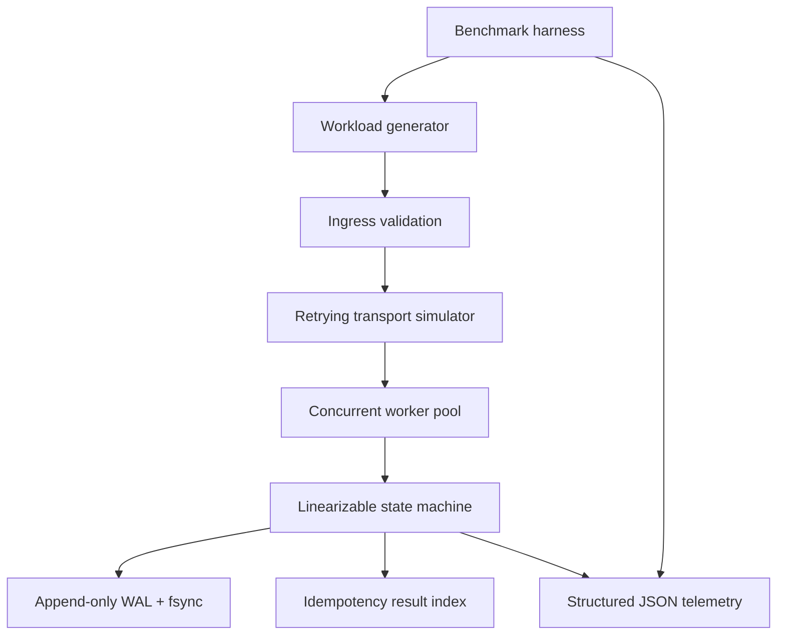

# ACPHDCO01 M1.5 — Deterministic Concurrent Processing Engine

## Scope
A reproducible laboratory implementation of a deterministic state-transition service. It provides validated operations (`add`, `set`), idempotency by operation ID, linearizable commits under a process-local mutex, append-only JSONL WAL persistence, restart recovery, JSON telemetry, concurrent workload generation, and lossy-transport retry simulation.

## Architecture


## Requirements
- Python 3.10+
- Install: `python -m venv .venv && . .venv/bin/activate && pip install -e . pytest`
- Tests: `pytest -q`
- Benchmark: `python benchmarks/run_benchmark.py --ops 10000 --workers 32 --target-rate 10000 --drop-rate 0.30`
- Docker: `docker compose up --build`

The benchmark writes a JSON report. It reports measured throughput and P50/P90/P99/P99.9 end-to-end latency in microseconds.

## Semantics and limits
- Commit order is the order in which worker threads acquire the engine lock. This is linearizable within one Python process.
- The WAL is appended and fsync'd before in-memory state mutation. Recovery replays complete contiguous records; a final incomplete line is ignored.
- Operation IDs provide at-most-once state mutation within the retained WAL. Repeated requests return the original result.
- The 30% packet-drop simulation drops requests before receiver processing. Retries use bounded decorrelated jitter. A finite retry limit means a theoretical residual delivery-failure probability remains; the harness records any such failure rather than hiding it.
- This is a single-process lab engine, not a production distributed consensus implementation. It does not claim Raft, Byzantine fault tolerance, multi-host replication, formal TLA+/Coq proof, or crash consistency across arbitrary filesystem/hardware failure.
- The lock serializes durable commits. Thread safety is demonstrated, but throughput depends on CPU, filesystem fsync latency, Python runtime, and host scheduling. Run on the target host before claiming the 10k ops/s target is met.

## Telemetry
Each operation emits one JSON log record with ISO-8601 UTC timestamp, trace ID, operation ID, latency in microseconds, status code, and commit sequence. Configure the Python logger `acp.engine` to capture records.

## Mathematical model
For M/M/m queueing, offered load is `a=lambda/mu`, utilization `rho=a/m`, and stability requires `rho<1`. This lab's benchmark is a finite-workload empirical test, not an M/M/m proof. Amdahl speedup bound is `S(K)=1/((1-p)+p/K)`. Tail latency is measured empirically by interpolated order statistics. Report conclusions must be tied to the JSON output from the actual run.

## Reproducibility
Record OS, CPU, Python version, worker count, fsync setting, operation count, target rate, drop rate, and WAL storage type alongside results. Use a fresh WAL for independent runs.


## Faculty evaluator guide

### Project summary
This submission implements a deterministic, thread-safe state-transition service for a controlled laboratory workload. Operations are validated before execution, identified by unique operation IDs, serialized at a linearizable commit point, and persisted through an append-only JSON Lines write-ahead log (WAL). The engine emits structured JSON telemetry and supports restart recovery. A transport simulator injects request loss and retries delivery with the same operation ID, allowing idempotency and integrity behavior to be evaluated under failure.

The implementation is intentionally a single-process prototype. Its mutex and WAL provide process-local ordering and persistence; they are not a distributed consensus protocol and do not provide multi-host fault tolerance.

### Reproducing the recorded benchmark
Use Python 3.10 or newer. From the repository root:

```bash
python -m venv .venv
# macOS/Linux
source .venv/bin/activate
# Windows PowerShell: .venv\\Scripts\\Activate.ps1

python -m pip install --upgrade pip
python -m pip install -e . pytest
pytest -q
python benchmarks/run_benchmark.py --ops 1000 --workers 16 --target-rate 1000 --drop-rate 0.30 --output benchmark-results.json
```

The benchmark uses a fresh temporary WAL by default. To retain the WAL for inspection, pass an explicit path, for example `--wal ./benchmark.wal`. The script prints the measured JSON result and writes it to the output path. Compare the output with the committed `benchmark-results.json`; elapsed time and latency percentiles will vary by CPU, Python version, operating system, and storage device.

### Recorded result and interpretation
The committed run submitted and committed 1,000 operations using 16 workers and a simulated 30% request-drop rate. It recorded 0 errors, an integrity check of PASS, and measured throughput of 554.08 operations/second. Recorded latency was P50 26,402.37 µs, P90 54,391.94 µs, P99 124,849.76 µs, and P99.9 147,798.43 µs. The benchmark's configured offered rate was 1,000 operations/second.

These measurements do **not** demonstrate achievement of a sustained 10,000 operations/second target. The recorded experiment is a 1,000-operation run, and its measured throughput was below its configured offered rate. Evaluators should distinguish the configured target rate from achieved throughput. A 10k-rate evaluation can be attempted with:

```bash
python benchmarks/run_benchmark.py --ops 10000 --workers 32 --target-rate 10000 --drop-rate 0.30 --output benchmark-10k.json
```

This is a test configuration, not a claim that 10k operations/second has been achieved. Report the actual output from the evaluator's machine.

### Suggested evaluation sequence
1. Run `pytest -q` and record the test count and result.
2. Run the reproduction command above and inspect `benchmark-results.json`.
3. Confirm `operations_submitted` equals `operations_committed`, `errors` is zero, and `integrity_check` is PASS.
4. Inspect telemetry for ISO-8601 UTC timestamps, trace identifiers, operation status, and latency in microseconds.
5. Restart the engine against a retained WAL to inspect recovery behavior.
6. Repeat with a higher operation count and worker count; compare throughput and tail latency rather than relying only on averages.

### Reflection and engineering trade-offs
The main design decision is to prioritize a clear correctness boundary over maximum parallel throughput. Worker threads can submit concurrently, but the state mutation and durable WAL append are serialized under a mutex. This simplifies linearizability and idempotency reasoning, while WAL fsync and lock contention limit throughput. The benchmark makes that trade-off visible rather than presenting concurrency as proof of scalability.

The failure-injection test models packet loss at the transport boundary; it does not drop real network packets. Retrying with a stable operation ID prevents a delivered operation from being applied twice. Bounded retries avoid unbounded retry storms, but a finite retry budget cannot guarantee delivery under arbitrary loss. The WAL and recovery design also depend on the guarantees of the host filesystem and storage hardware.

A production extension would separate ingress from durable commit, introduce bounded queues and admission control, add back-pressure and retry budgets, and use a transactional replicated log or a formally specified consensus protocol for multi-node operation. Those capabilities are future work and are not claimed as implemented here.

### Scope of claims
This is an educational, reproducible single-process prototype. It demonstrates deterministic state transitions, thread-safe commits, WAL-based recovery, structured telemetry, and simulated-loss retry behavior. It does not claim distributed consensus, Byzantine fault tolerance, formal verification, multi-host replication, or a proven 10,000 operations/second capacity.
