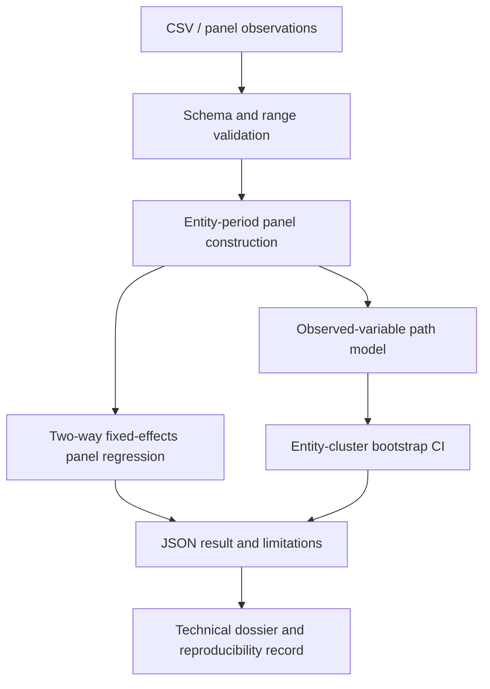

# ACPHDCO02-M2.5 — AI-assisted Software Quality: Longitudinal & Panel Analytics

## Research question
Does AI-assisted test automation relate to increased test coverage and reduced defect-resolution time across software teams over time?

## Scope and honest boundary
This lab provides a reproducible analytical pipeline for a team-by-period panel. It validates entity-period uniqueness and numeric ranges, estimates a two-way fixed-effects panel regression, and calculates an observed-variable mediation path model with a cluster bootstrap interval for the indirect effect.

The path model is **not a full latent-variable SEM**: it does not estimate latent constructs, factor loadings, or a measurement model. It is an observed-variable path-analysis component suitable for demonstrating mediation mechanics. Do not label it a full covariance-based SEM.

The included dataset is generated synthetically with a fixed random seed. It is used to test the software and demonstrate the workflow, not to make claims about actual organizations or establish that AI adoption causes better software quality. Replace it with ethically collected, documented organizational panel data before making substantive claims.

## Architecture


## Run
```bash
python -m pip install -e . pytest
pytest -q
python examples/run_panel_analysis.py --teams 24 --periods 12 --bootstrap 200 --seed 20261109
```

The command writes `synthetic-panel.csv` and `panel-analysis-results.json`.

## Statistical specification
Panel model:

`resolution_hours_it = beta1*ai_adoption_it + beta2*test_coverage_it + entity_FE_i + period_FE_t + error_it`

Standard errors are clustered by team. The path model estimates:

- a: AI adoption -> test coverage
- b: test coverage -> resolution time, controlling for AI adoption
- c': direct AI adoption -> resolution time
- indirect effect: a*b
- total effect: c' + a*b

The indirect-effect interval is estimated by resampling teams (clusters), not individual rows.

## Interpretation constraints
- Fixed effects control for time-invariant team differences and common period shocks represented by period indicators; they do not remove time-varying confounding.
- Cluster-robust inference is fragile with a small number of teams. Report the cluster count and avoid treating p-values as definitive.
- Missing data, selection, reverse causality, measurement validity, and parallel trends (if making a causal before/after claim) require separate investigation.
- Synthetic-data coefficients are determined partly by the data-generating process and are not empirical findings.


## Container deployment
Build and run the panel analysis:
```bash
docker compose up --build analytics
```
The output files are written to `./data/panel-analysis-results.json` and `./data/synthetic-panel.csv`.

The separate processing stress test is opt-in:
```bash
docker compose --profile stress run --rm benchmark
```
This stress test measures the existing deterministic processing subsystem. Its results must be reported separately from the panel-analysis results; passing one does not validate the other.


## Validation snapshot (local container run)
The current processing benchmark logic was exercised with 10,000 submitted operations, 32 workers, a configured 10,000 operations/second offered rate, and 30% simulated pre-receiver request loss. On a Linux x86_64 container reporting 3 CPUs and Python 3.13.5, all 10,000 operations committed with zero handler errors and an integrity check of PASS. Measured throughput was **2,394.27 operations/second**, not 10,000. Latency was P50 11,772.99 µs, P90 22,941.47 µs, P99 45,096.98 µs, and P99.9 65,569.51 µs.

This is a useful resilience result but a performance shortfall. The configured offered rate must not be confused with achieved throughput. The result is environment-specific, is not a sustained soak test, and the loss model is not equivalent to real network partitions. Full JSON evidence is in `results/processing-stress-10k.json`.
