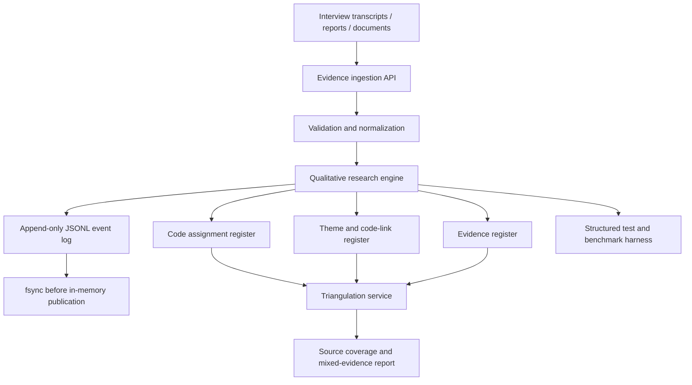
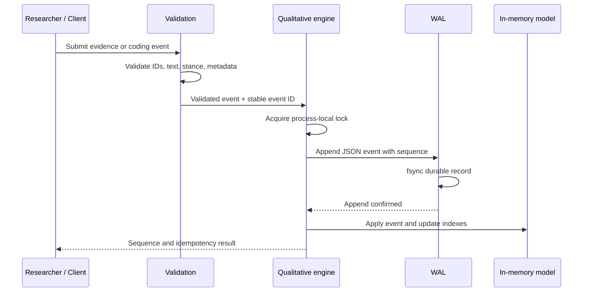

# M3.5 Architecture and Research Method

## Purpose
M3.5 extends the existing deterministic processing foundation with a qualitative research workspace. The software manages evidence excerpts, human-authored code assignments, themes, and cross-source evidence summaries. It is an audit and organization tool; it does not replace researcher interpretation.

## Component diagram



## Mutation sequence



## Data model
- Evidence: unique evidence ID, source ID, source type, excerpt, JSON metadata.
- Code assignment: unique assignment ID, evidence ID, code label, coder ID, stance, analytic memo.
- Theme: unique theme ID, name, description.
- Theme-code link: association between a theme and an existing assigned code.
- Event: sequence, stable event ID, UTC timestamp, event type, and payload.

## Determinism and durability
Mutations are serialized by a reentrant process-local lock. Each accepted event is appended as one canonical JSON line and fsync'd before in-memory state is changed. Event IDs are idempotency keys; reusing an ID with a different payload is rejected. Recovery replays complete contiguous events. An incomplete final WAL record is truncated before subsequent appends, preventing a torn tail from corrupting the next record.

This design provides process-local linearizable mutations and WAL-based restart recovery. It does not provide multi-process coordination, multi-host replication, consensus, or guarantees against arbitrary storage hardware failure.

## Triangulation semantics
The triangulation service groups coded excerpts by source ID and reports:
- distinct source count;
- sources with supporting coded evidence;
- sources with contradicting coded evidence;
- the evidence IDs and codes contributing to each source;
- a status of insufficient_sources, mixed_evidence, cross_source_support, or inconclusive.

Multiple excerpts from one source count as one source. The status is a coverage indicator, not a statistical test and not proof of truth. Researchers must assess source independence, quality, context, coding consistency, negative cases, and alternative explanations.

## Qualitative-methodology boundary
Grounded Theory requires iterative comparison, memoing, theoretical sampling, and researcher-led theory development. Phenomenology requires careful interpretation of lived experience and reflexivity. The software supplies traceability and organizing primitives; it does not claim to implement these methodologies automatically. Human researchers remain responsible for code definitions, coding decisions, theme interpretation, saturation judgments, and conclusions.

## Benchmark methodology
The qualitative benchmark submits synthetic evidence-ingestion events concurrently. A seeded injector drops requests before receiver processing at the configured probability. Retries reuse the same event ID, and delays are bounded and randomized. The harness reports offered, delivered, committed, failed, throughput, P50/P90/P99/P99.9 latency, retry count, WAL durability, and an integrity check.

The simulated loss is application-level request loss, not physical network packet loss. The benchmark measures the supplied host and storage stack; it cannot establish a universal 10,000 operations/second capacity. Report the actual measured output and environment.

## Reproduction
```bash
python -m pip install -e .
python -m pip install -r requirements-m3.5.txt
pytest -q
python benchmarks/run_qualitative_benchmark.py --ops 10000 --workers 32 --drop-rate 0.30 --output m3.5-qualitative-benchmark.json
```
