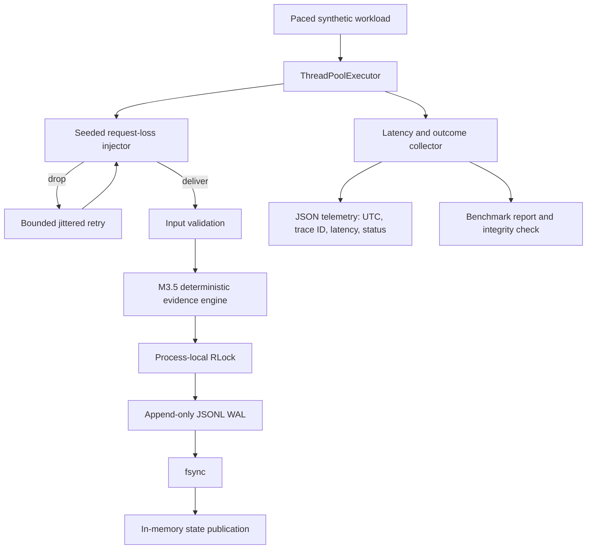

# M4.5 Implementation Status

## Branch and baseline

- Branch: `m4.5-literature-synthesis-engine`
- Baseline: `m3.5-qualitative-engine`
- Earlier branches are preserved; this work is isolated from `main`, `m2.5-extension`, and `m3.5-qualitative-engine`.

## Implemented in this increment

- Reuses the M3.5 deterministic qualitative evidence engine and its append-only JSONL write-ahead log.
- Adds `JsonTelemetry` with UTC ISO-8601 timestamps, trace IDs, operation names, latency in microseconds, status codes, and optional error type.
- Serializes telemetry writes from concurrent workers with a process-local lock.
- Adds a paced concurrent benchmark with configurable offered rate, worker count, seeded 30% application-level request drops, bounded randomized retries, and stable event IDs.
- Reports offered, delivered, committed, and failed operations separately.
- Reports P50, P90, P99, P99.9, mean latency, observed offered rate, committed throughput, retry/drop counts, runtime environment, WAL durability setting, and integrity result.
- Reopens the WAL after the benchmark and compares recovered state with live state before reporting integrity PASS.\n- Adds telemetry tests, a dedicated M4.5 Dockerfile, a GitHub Actions workflow, and a technical reflection for coursework lodgement.

## Measurement and failure-model boundaries

The failure injector drops requests in the benchmark process before the receiver invokes the engine. It is application-level request loss, not physical network packet loss. The benchmark uses a seeded pseudo-random generator per operation so the workload is reproducible for the same parameters and runtime behavior.

The benchmark only reports zero data loss when every offered operation is committed, no request exhausts its retry budget, and the recovered engine sequence equals the number of offered operations. A PASS is limited to this experiment and host/storage environment; it is not a proof against arbitrary process, filesystem, hardware, or multi-host failures.

Latency percentiles are end-to-end from task submission to completion, including worker-queue delay, retry delays, and engine commit. The offered rate is paced by the benchmark scheduler; actual observed rate is measured and reported rather than assumed.

## Architecture



## Reproduction

Install the project and test dependencies:

```bash
python -m pip install -e .
python -m pip install -r requirements-m2.5.txt
python -m pip install -r requirements-m3.5.txt
python -m pip install pytest-cov
```

Run tests:

```bash
pytest -q --cov=acp_engine --cov-report=term-missing --cov-report=xml
```

Run the 10,000-operation, 10,000 offered-operations/second workload with 30% simulated request loss:

```bash
python benchmarks/run_m4_5_benchmark.py \
  --ops 10000 --target-rate 10000 --workers 32 --drop-rate 0.30 \
  --output m4.5-benchmark.json --telemetry m4.5-telemetry.jsonl
```

Build and run the container:

```bash
docker build -f Dockerfile.m4.5 -t acp-m4-5 .
docker run --rm -v "$PWD/artifacts:/data" acp-m4-5
```

## Not yet verified

- GitHub Actions test and benchmark results for this branch.
- Actual sustained throughput and P50/P90/P99/P99.9 values on the CI host.\n- Successful WAL recovery check from an actual benchmark run.
- Coverage percentage and whether it exceeds the rubric's 90% high-distinction threshold.
- Docker build and container execution.
- Physical network packet-loss testing (not implemented by this application-level injector).
- Multi-process or multi-host coordination, consensus, or production deployment guarantees.

Do not present any of these unverified items as completed. Update this file only after inspecting the actual CI artifacts and recording the measured values.
